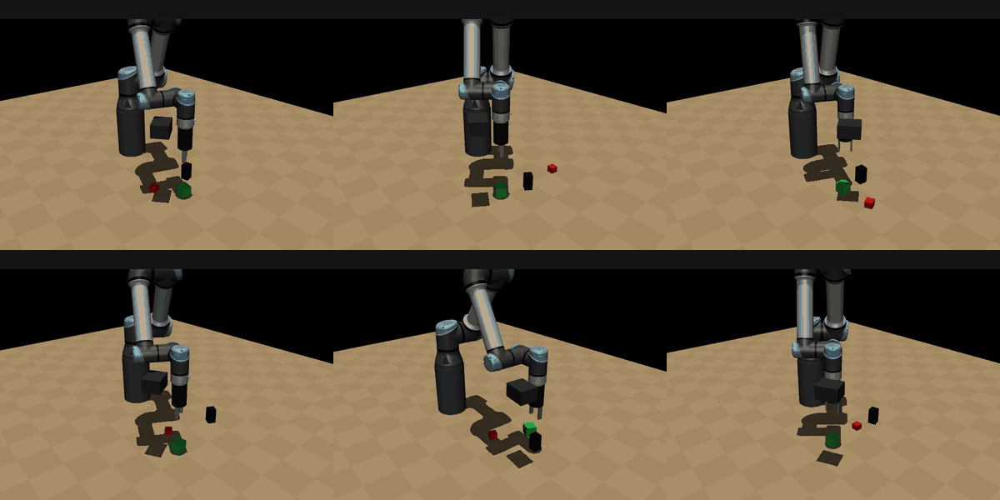
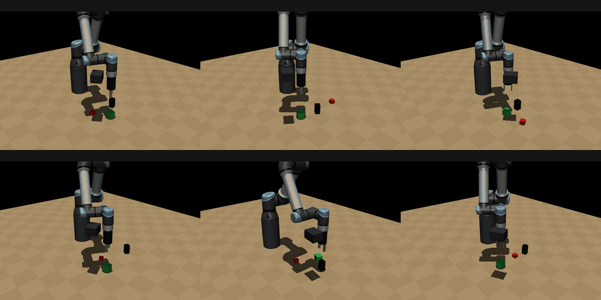
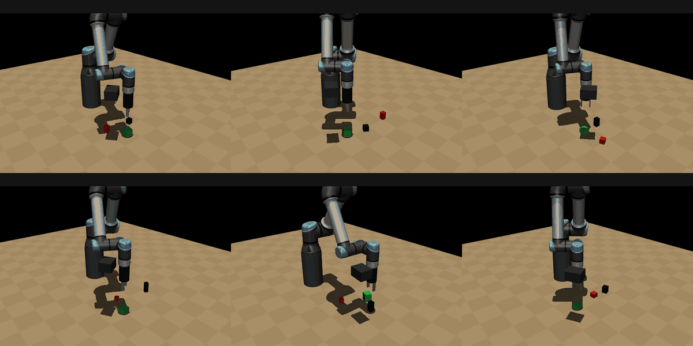

# ur-pen-signature

A UR7e picks up a pen lying on a support with a learned grasp, turns it tip-down and signs with it. Simulation in MuJoCo first, then the EECS 106A lab cell at UC Berkeley (UR7e, Robotiq Hand-E, Logitech C922 on the wrist).

Learning where it helps, control where control is better: the grasp is a PPO policy trained under camera error and randomized pens; the signature is a Cartesian trajectory with a regulated pen force.

A second task stacks the three lab blocks into a tower, with a scripted stack and an end-to-end SAC policy ([Tower of blocks](#tower-of-blocks)):



## Results (simulation)

Grasp success over the same 300 episodes with camera error (3 mm, 4 deg, one-step latency), and 200 with the exact pen pose:

| | Camera error | Bottle | Post | Bridge | Exact pose |
|---|---|---|---|---|---|
| Scripted grasp (baseline) | 74 % | 48 % | 73 % | 90 % | 98.5 % |
| PPO residual on the scripted grasp | **84 %** | 60 % | 88 % | 92 % | 93.5 % |

A success is the pen lifted 8 cm with its tip on the side away from the wrist camera. Pens are 12 to 16 cm long, 7 to 12 mm wide and 6 to 25 g, on a post, a two-post bridge or a lying bottle. The residual policy (4M steps, PPO) cuts the failures under camera error by 40 %, and gives up a few points when the pose is exact: it learned to be careful.

The gripper now matches the lab one, fingertips 16 cm below the flange. The residual policy and the signature numbers come from the earlier 18 cm model and were not retrained; that policy is not in the repository, so its row is not re-evaluated. The scripted rows are on the 16 cm gripper, and the scripted grasp moved by 2 points at most.

Signature after the learned grasp (CD monogram, 8 cm wide, 3 cm/s): mean distance from the ink to the reference 0.11 mm, 95th percentile 0.19 mm, 100 % of the reference inked, pen force 1.51 N for a 1.5 N target.

## How it works

- `pensig/scene.py`: UR5e model from MuJoCo Menagerie (the UR7e has the same kinematics), Hand-E with the lab fingers (fingertips 16 cm below the flange, measured), wrist camera mount, base 0.275 m above the table as in the lab.
- `pensig/env.py`: Gymnasium environment. Action: TCP displacement, yaw, gripper. Damped least-squares IK turns the TCP target into joint commands, as servoL would. A protective stop ends the episode when the gripper or the pen presses on the table or a support, as on the real arm.
- `pensig/scripted.py`: the hand-written grasp the policy has to beat, on the same pose estimate.
- `pensig/residual.py`: the environment where PPO learns a correction on top of the scripted grasp.
- `pensig/draw.py`: turns the pen tip-down and traces the strokes; an admittance loop on the pen force stands in for force_mode.
- `scripts/`: `train.py` (PPO, Stable-Baselines3), `evaluate.py`, `draw_signature.py`, `capture_signature.py` (sign with the mouse), `fetch_assets.py`.

## Run

```
python -m venv .venv && .venv/Scripts/activate
pip install -e ".[dev]"
python scripts/fetch_assets.py
python -m pytest -q
python scripts/evaluate.py --scripted --episodes 200
python scripts/train.py --residual --timesteps 4000000 --out runs/residual
python scripts/evaluate.py --residual --policy runs/residual/final_model.zip --episodes 300
python scripts/capture_signature.py --out examples/my_signature.json
python scripts/draw_signature.py --residual --policy runs/residual/final_model.zip --strokes examples/my_signature.json --video results/signature.mp4
```

## What the simulation taught me

- MuJoCo contacts are stiff in proportion to the object's mass: a 10 g pen squeezed at 40 N sinks millimeters into the pads. The grasp uses 8 to 20 N; the drawing phase squeezes at 40 N with noslip iterations, or the pen creeps 0.8 mm per stroke.
- Without rolling and torsional friction on the pads, a pen grasped off its center of mass pivots in the fingers as it lifts. Soft pads resist that rotation; modeling it took the scripted grasp under camera error from 60 % to 74 %.
- A scripted P controller with full gain oscillates when the arm answers one period late, and never reaches its tolerance: halving the gain took the baseline from 36 % to 60 %. A fair baseline matters before claiming that RL beats it.
- My first reward paid +25 for a success that ended the episode, while hovering next to the pen earned about 1.5 per step until the time limit. PPO from scratch (8M steps) learned to hover with the gripper open, and a residual policy started at 47 % and unlearned the grasp down to 1 %. Paying the best per-step reward for every step left after a success fixed it.
- Cylinder-box contacts misbehave when a pad pinches the rim; the pen is a capsule.
- With the gripper pointing away from the base, the forearm hits the table while drawing; pointing it back at the base keeps every paper position reachable.
- The wrist camera sits on one side of the gripper: the pen must be grasped with its tip on the other side, or the mount reaches the paper before the pen.
- With the stiff coupling between the Hand-E fingers, a closed gripper chattered in place and never reopened. The pen grasp never reopens, so it took the tower to find it; more finger armature fixes it.
- The 1 kg gripper accelerating shows on the wrist force as much as a block touching down: the touchdown check only runs over the last 12 mm, at constant speed.

## Toward the real arm

The simulation world frame is the UR controller base frame shifted up by the pedestal height, so TCP targets map to `ur_rtde` servoL directly. Still to do: pen detection with the C922, a touch-off to measure the tip position in the gripper, force_mode for the pen-down phase, and grooved fingers for the pen.

## Tower of blocks

A second task in the same cell, with the gripper never close to the table: stack the three lab blocks (green 50 mm, black 40 x 50 mm, red 35 x 40 mm, sizes estimated from a photo) into one tower (`results/tower_preview.png`: start, black block coming down, finished tower at 14 cm). The green block is wider than the 50 mm Hand-E stroke, so it stays where it is and is the base. Each episode places one block; `next_stage()` chains the two placements without resetting the physics.

- `pensig/tower.py`: Gymnasium environment, same action and protective stop as the pen grasp. Block poses come from the camera estimate (3 mm, 4 deg), replaced by a wrist-camera close-up (1 mm, 1.5 deg) once the TCP is above the block; the wrist force sensor, zeroed per placement, is in the observation. The fingertips stay 15 mm above the bottom of the block.
- `pensig/tower_scripted.py`: pick and carry, going down only on the wrist estimate, and a touchdown at 6 cm/s, then 1 cm/s over the last 12 mm, that stops on the wrist force, like `moveUntilContact`.
- `pensig/residual.py`: `ResidualTowerEnv`, PPO on top of the scripted stack, with a small gripper correction.

Same 200 full towers under camera error (a placement counts within 8 mm and 10 deg, released and cleared):

| | Full tower | Black on green | Red on black | Placement error |
|---|---|---|---|---|
| Scripted stack | **93 %** | 96 % | 96.9 % | 1.6 mm |
| PPO residual on the scripted stack (500k steps) | 78 % | 86 % | 90.7 % | 2.0 mm |
| Scripted stack, first estimate only | 52 % | 66 % | 78.8 % | 4.0 mm |
| Scripted stack, exact poses | 98.5 % | 98.5 % | 100 % | 0.3 mm |

Here control is better, and the gain came from information, not training. Before the wrist estimate the script built 39 % of the towers and the best of four PPO runs 19.5 %: most failures were a finger landing on top of the black block (40 mm in a 50 mm stroke leaves 5 mm per side) or a block set down off center, both from a camera error the policy could not see. With the close-up, the script reaches 93 %. On top of it, PPO fell from 90 % to about 80 % of placements while training and built 78 % of the towers at 500k steps (trained with the 18 cm gripper, evaluated with the 16 cm one), so I did not run the 4M steps. The remaining script failures are a finger catching the top edge of the block as it closes; feeling for the edge with the wrist force is the next step.

What the five runs taught me:

- Paying the hold over the tower as much as the release taught the first policy to keep the block in hand.
- An initial exploration std of 0.3 (a 2 mm random step every period) took the script from 50 % to 20 % of placements; PPO learned from failures and drifted further. The tower now starts at 0.1.
- Paid per step, holding the block earned 2.5 every step while the success bonus came 20 steps later, discounted by gamma = 0.98: with half the placements succeeding, stalling was worth more than trying. The progress is now paid as a potential difference, with a fixed bonus and penalty. That stopped the drift, but not the plateau.
- A released block dropping 2 mm onto the tower spiked the contact force past the protective stop. The arm cannot feel a block it no longer holds, so the held block counts only while a finger touches it.
- Coming down at full speed, the arm lagged the command by 9 mm and landed hard; the touchdown now starts at 6 cm/s.
- Training runs at 170 to 400 steps/s on 8 cores (4M steps take 3 to 6 hours) and at 1300 steps/s on a 32-core node.

```
python scripts/evaluate_tower.py --scripted --episodes 200
python scripts/train.py --task tower --residual --timesteps 4000000 --out runs/tower
python scripts/evaluate_tower.py --residual --policy runs/tower/final_model.zip --episodes 200
python scripts/train.py --task tower --residual --block-sizes 0.05 0.05 0.04 0.08 0.035 0.03     --resume runs/tower/final_model.zip --timesteps 500000 --n-envs 32 --out runs/tower_measured
```

Measured on the lab blocks (heights with a ruler: green 50 mm, black 80 mm, red 30 mm; widths still from the photo), with `--block-sizes 0.05 0.05 0.04 0.08 0.035 0.03`, 200 towers:

| | Full tower | Black on green | Red on black | Placement error |
|---|---|---|---|---|
| Scripted stack | **91.5 %** | 93.5 % | 97.9 % | 1.6 mm |
| PPO residual above, 500k more steps on these sizes | 83 % | 90.5 % | 91.7 % | 2.0 mm |
| PPO residual above, not retrained | 55 % | 81.5 % | 67.5 % | 2.1 mm |

The policy trained on the photo sizes breaks on the real ones; 500k more steps bring it back to 83 %, still under the script.

On the real UR7e (`ros2/tower_ros`), black on green worked on the first run in step mode, stopping at 3.1 N on contact. The RealSense reads the tops of the green and black blocks 8 and 15 mm low; `config/tower.yaml` corrects each block.

### End-to-end policy

The policy alone, no script at run time. SAC with the script's episodes in the replay buffer and a cloning term on them (`pensig/rlpd.py`, `scripts/train_tower_sac.py`); episodes start partway through the script, earlier as the policy succeeds; random block sizes; open/closed gripper as on the lab arm. 13 hours on a 32-core node.

Six consecutive seeds on the measured blocks, not picked. SAC policy (3 of 6 towers):


Scripted stack, same seeds (6 of 6):



SAC policy, random block sizes (4 of 6):



100 full towers from the start pose:

| | Measured blocks | Random sizes |
|---|---|---|
| Scripted stack (200 towers) | **91.5 %** | not run |
| SAC, best checkpoint (3M steps) | 60 % | 71 % |
| SAC, final model (8.9M steps) | 10 % | 30 % |

Once the first block is placed, the policy places the second 97 % of the time; nearly all failures are on the first block (18 protective stops and 15 timeouts out of 100). Four bugs broke the earlier runs:

- The elapsed time was in the observation and reset at each start partway through: the policy closed the gripper by the clock, not on the block.
- With the gripper open above the tower, nothing said whether a block had been carried there; a flag set by closing on the block fixed it.
- Randomized block masses without `mj_setConst` made heavy grasps blow up numerically, read as protective stops.
- The entropy term in the critic target cost more over an episode than a protective stop, so stopping early looked cheap; from 6M steps the policy closed on the top of the block. The target now leaves it out (SAC-Lite).

Towers still peak around 3M steps and slide after 7M as the entropy coefficient keeps rising; `best/` keeps the peak.

```
python scripts/train_tower_sac.py --out runs/tower_sac --timesteps 30000000 --buffer 12000000
python scripts/train_tower_sac.py --eval-only runs/tower_sac/best/best_model.zip
python scripts/tower_grid_gif.py --policy runs/tower_sac/best/best_model.zip --out media/tower_sac_measured.gif
```

## License

MIT. The UR5e model comes from MuJoCo Menagerie (BSD-3) and is downloaded by `scripts/fetch_assets.py`.
